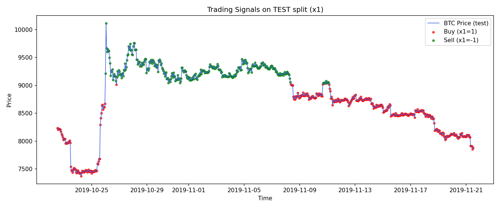
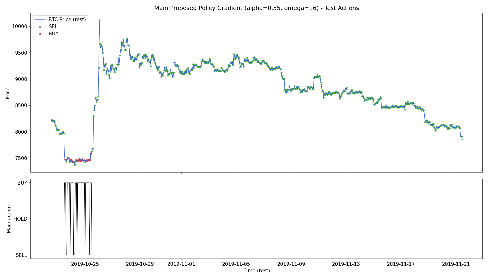

# BTCAgent — Trading de Bitcoin con Aprendizaje por Refuerzo

Replicación del paper *"Multi-level deep Q-networks for Bitcoin trading strategies"* (Sattarov & Choi, Scientific Reports, 2024): un agente de aprendizaje por refuerzo profundo que decide cuándo comprar, vender o mantener Bitcoin combinando el precio histórico por hora con el sentimiento de Twitter. Implementamos la arquitectura jerárquica de tres redes (M-DQN), un entorno de simulación propio y una variante experimental con *policy gradient*, y evaluamos con honestidad por qué los resultados originales no se reprodujeron. Proyecto académico del curso de Inteligencia Artificial, desarrollado en un equipo de 5 personas.

---

## Tecnologías Utilizadas

**Lenguaje:** Python

**Aprendizaje por refuerzo:** Deep Q-Networks (TensorFlow/Keras), replay buffer, *policy gradient*

**Sentimiento:** puntajes VADER de tweets sobre Bitcoin, agregados por hora

**Datos y visualización:** pandas, NumPy, Matplotlib

**Calidad:** pytest, checkpoints reanudables, registro de ejecuciones

---

## Características

- **Arquitectura jerárquica de tres niveles:**
  - **Trade-DQN:** recomienda comprar o vender a partir del precio y el sentimiento.
  - **Predictive-DQN:** estima la variación del precio.
  - **Main-DQN:** toma la decisión final combinando ambas señales, con control explícito del riesgo (`alpha`) y del número máximo de operaciones diarias (`omega`).
- **Sentimiento social:** integra el sentimiento de tweets sobre Bitcoin (puntajes VADER), agregado y alineado hora a hora con el precio.
- **Evaluación financiera:** ROI, Sharpe Ratio, número de operaciones y capital final sobre 30 días de prueba (720 horas), partiendo de US$ 1,000,000 simulados.
- **Pipeline reanudable:** ejecución por fases con presupuesto de tiempo, checkpoints de pesos, optimizador y replay buffer, para retomar entrenamientos largos sin empezar de cero.
- **Modelos entrenados incluidos:** los pesos de las tres redes están en `utils/checkpoints/`.

---

## El Proceso

**Datos.** El paper original usa precios de 2014 a 2019 y un dataset de tweets que no está disponible públicamente. Reconstruimos el entorno con fuentes alternativas: precios horarios de Bitcoin y tweets de Kaggle con los hashtags #Bitcoin y #BTC, con puntajes de sentimiento VADER. Los periodos de ambas fuentes no coincidían por completo, y documentamos ese desajuste como una de las causas principales de las diferencias en los resultados.

**Entrenamiento por etapas.** Primero se entrenan la Trade-DQN y la Predictive-DQN, que generan sus señales (`x1` y `x2`) para cada hora. Luego la Main-DQN aprende a operar usando esas señales, evaluada en una grilla de niveles de riesgo (`alpha` = 0.30, 0.55 y 0.80).

**Entrenamientos largos.** Como cada corrida tomaba horas, construimos un orquestador por fases con presupuesto de tiempo y checkpoints completos (pesos, estado del optimizador y replay buffer). Si una corrida se interrumpe, se reanuda desde el último punto guardado.

**Mejora experimental.** Propusimos reemplazar la política de la Main-DQN por un enfoque de *policy gradient* y la comparamos contra las dos variantes del paper con las mismas condiciones.

---

## Resultados

| Variante (alpha = 0.55) | ROI | Sharpe Ratio | Operaciones |
|---|---|---|---|
| Baseline clásico (paper) | 0.00 % | 0.00 | 0 |
| **Baseline propuesto (paper)** | **+3.52 %** | **0.14** | 78 |
| Mejora con policy gradient | +1.06 % | -0.11 | 39 |

El paper original reporta un ROI cercano al 30 % y un Sharpe Ratio mayor a 2.7. **Nuestra replicación no alcanzó esos valores.** El mejor resultado fue el baseline propuesto con `alpha = 0.55`, y la mejora con *policy gradient* no lo superó en promedio.

Lo que encontramos al analizarlo:
- **Alta sensibilidad al riesgo:** con `alpha` alto, varias variantes aprendieron a no operar (0 operaciones), y con `alpha` bajo, a operar en exceso con pérdidas.
- **Señal predictiva débil:** la Predictive-DQN acertó la dirección del precio en un 50 % de los casos en prueba, equivalente al azar, lo que limita al agente principal.
- **Calidad de datos:** el desajuste temporal entre precios y tweets afecta directamente el valor del sentimiento como señal.

| Señales de la Trade-DQN en prueba | Decisiones del agente con policy gradient |
|---|---|
|  |  |

El análisis completo está en el [paper del proyecto](docs/BTCAgent_paper.pdf) y en el [reporte final de la corrida](results/20260227_001839/final_report_20260227_001839.md).

---

## Lo Que Aprendí

Aprendí que replicar un paper es tan exigente como proponer uno: la arquitectura se puede reproducir, pero los resultados dependen de detalles de datos que no siempre están disponibles. También aprendí a diseñar entrenamientos largos que sobreviven a interrupciones y a reportar con honestidad un resultado que no confirma la hipótesis.

---

## Cómo Puede Mejorarse

- **Datos alineados:** conseguir precios y tweets del mismo periodo, o reemplazar Twitter por otra fuente de sentimiento con cobertura continua.
- **Mejor señal predictiva:** sustituir la Predictive-DQN por un modelo de series de tiempo (por ejemplo, LSTM) evaluado por separado.
- **Costos reales de operación:** incluir comisiones y deslizamiento en el entorno para una evaluación más realista.
- **Búsqueda de hiperparámetros:** explorar más valores de `alpha` y `omega`, dada la alta sensibilidad observada.

---

## Cómo Correr el Proyecto

### Requisitos
- Python 3
- Dependencias principales: TensorFlow, pandas, NumPy, Matplotlib y pytest

### Datos
Coloca los archivos de entrada en `data/raw/` (no se versionan):
- `data/raw/bitcoin_price/btc_hourly.csv`
- `data/raw/twitter/engtweetsbtc_vader_sentiment.csv`

Los datos ya procesados y las señales intermedias están en `data/processed/`.

### Ejecución

```bash
python main.py
```

El pipeline corre por fases (preparación, pre-modelos, agente principal y evaluación) y guarda tablas, gráficas y reportes en `results/<fecha_hora>/`. Las pruebas se ejecutan con:

```bash
pytest tests/
```

---

## Equipo

M. Ariza · J. Flores · A. Guerra · R. Inca · J. Tintaya

Basado en: Sattarov, O. & Choi, J. (2024). *Multi-level deep Q-networks for Bitcoin trading strategies*. Scientific Reports. [DOI: 10.1038/s41598-024-51408-w](https://doi.org/10.1038/s41598-024-51408-w)
